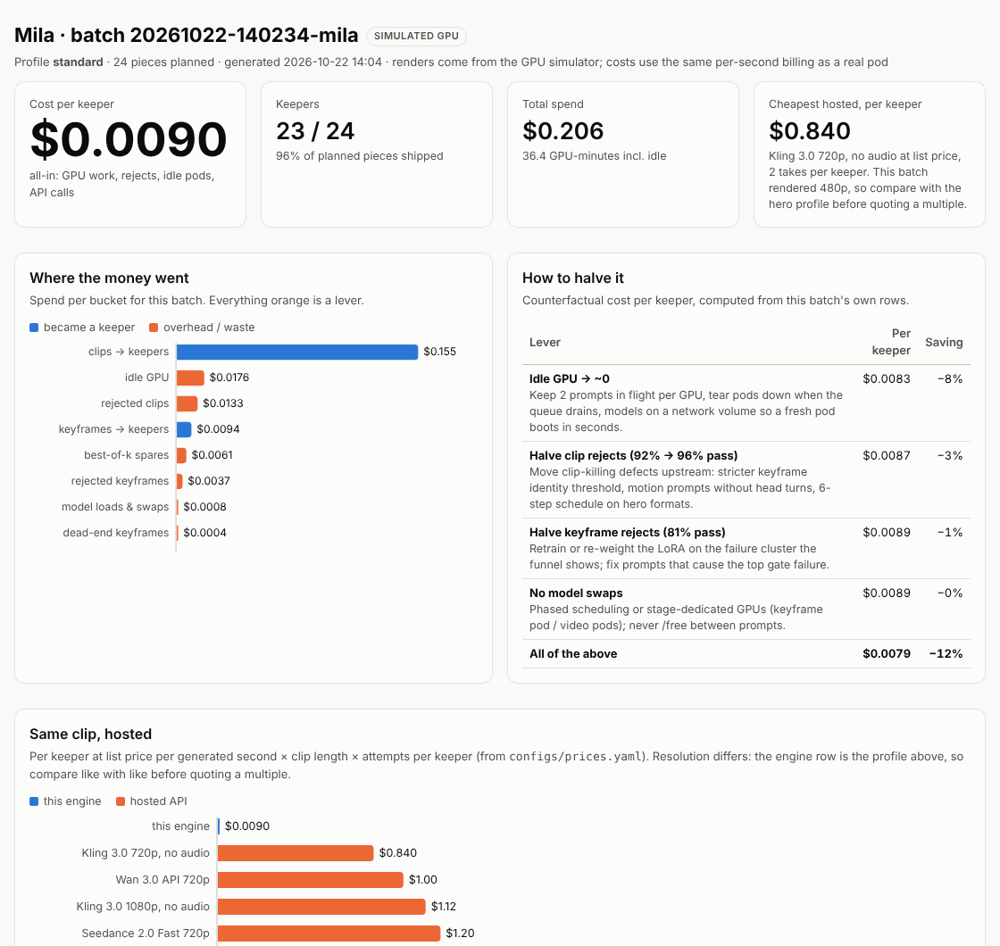
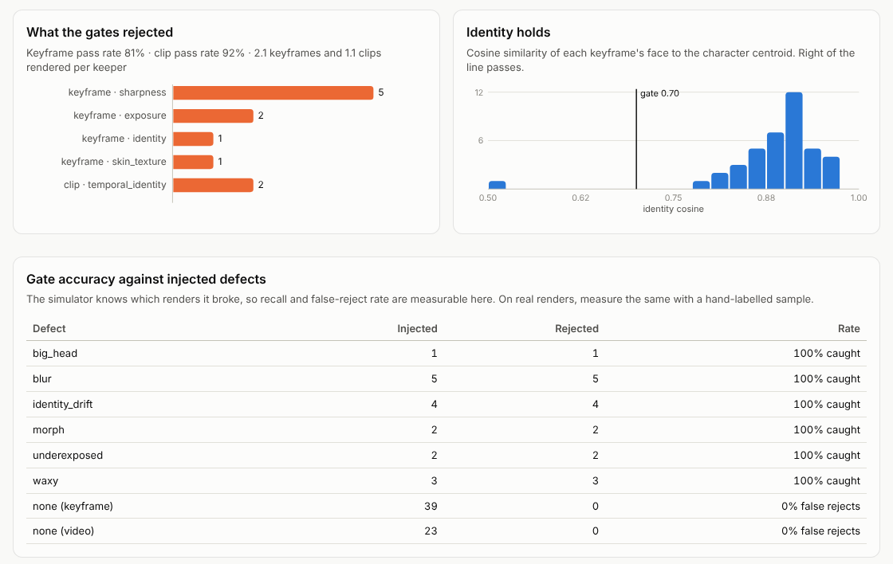

# creator-engine

A batch engine that turns a character LoRA into hundreds of gated, cost-accounted short clips a day on
rented GPUs, publishes them across accounts, and learns from the views which formats to make more of.

```
character LoRA ─▶ keyframes ─▶ keyframe gates ─▶ Wan 2.2 clips ─▶ clip gates ─▶ keepers ─▶ accounts
   (ComfyUI, Z-Image Turbo)   identity · skin ·    (lightx2v       flicker · motion ·          │
                              head size · signs     4-step)        identity across frames      │
        ▲                                                                                      │
        └──────────── formats re-weighted by views vs each account's own baseline ◀────────────┘
                                  every GPU-second lands in a cost ledger
```



## Status: what is real and what is simulated

**Real and tested:** the ComfyUI API client, the GPU pool (routing, retries, session billing), the
batch runner (phased scheduling, best-of-k keyframes, budget cap, resume), every quality gate, identity
enrollment, the cost ledger and halving plan, the format bandit, the scheduler and the Instagram Graph
API publisher (against a mocked API), RunPod pod lifecycle (against a mocked API), the Claude judge
(against a mocked client), the MCP server, and the HTML report. 42 tests, Python 3.11 to 3.13.

**Simulated:** the GPUs. This repo was built without a GPU, so `sim/` provides a ComfyUI-compatible
server that validates graphs like ComfyUI, executes one prompt at a time, pays cold-load and
model-swap penalties, bills by a timing model anchored to ComfyUI's published Wan 2.2 numbers, and
renders procedural stand-ins with injected defects (blur, waxy skin, identity drift, big heads,
misspelled signs, frozen or flickering clips, faces morphing mid-shot). The engine talks to it over
HTTP exactly as it talks to a pod, and the gates run on its pixels, not on metadata.

**Not yet done:** a real-GPU run with a trained character LoRA. [docs/gpu-runbook.md](docs/gpu-runbook.md)
is the path; it is a ~$10-20 job on RunPod, and the report it produces replaces the screenshot above.

## Results on the simulator (`ce demo`, 3 rounds × 24 pieces, two RTX 4090 pods at $0.34/h)

| | Round 1 | Round 2 | Round 3 |
|---|---|---|---|
| Quotas | 8 / 8 / 8 (no data yet) | mirror-walk 21, cafe 2, street 1 | mirror-walk 24 |
| Keepers | 23 / 24 | 22 / 24 | 23 / 24 |
| Cost per keeper (all-in) | $0.0101 | $0.0114 | $0.0090 |

- **Gates:** 71 of 72 injected defects caught; 0 false rejects across 174 clean renders.
- **Experiments:** the format with the best hidden appeal (mirror-walk) was identified after the first
  round of posts and given most of the volume; the weakest format was killed in round 2.
- **Hosted, same 5 s clip:** Kling 3.0 720p silent at list price is $0.42 per generation, $0.84 per keeper
  at two takes. The engine's `standard` profile is 480p, so the fair comparison is the 720p `hero`
  profile at an estimated ~$0.016 per render, roughly 25-30× cheaper after yield. The full table and
  every caveat are in [docs/cost-model.md](docs/cost-model.md).

## Quickstart

```bash
pip install -e ".[dev]"
ce demo                 # ~3 min on a laptop: 2 simulated pods, 3 rounds, report in runs/demo/reports/
pytest -q               # ~2 min
ce costs                # per-clip GPU cost by profile vs hosted APIs
```

## How it works

| Stage | What happens | Code |
|---|---|---|
| Plan | Format quotas come from the experiment loop; each piece gets a scene × outfit × light × hook variant and deterministic seeds, so a crashed batch resumes exactly. | `planner.py`, `experiments.py` |
| Keyframes | Z-Image Turbo + the character LoRA in ComfyUI, best-of-k per piece; the candidate with the highest identity score among those that pass wins. | `workflows/keyframe_zimage_lora.json` |
| Keyframe gates | exposure, one face, focus, head size for the shot, skin texture, identity vs the enrolled centroid, sign text via OCR. Cheapest first, stop at the first failure. | `gates.py` |
| Clips | Wan 2.2 I2V 14B fp8 (high/low-noise experts) + lightx2v 4-step LoRAs, from the gated keyframe. | `workflows/i2v_wan22_lightx2v.json` |
| Clip gates | flicker, motion (frozen or chaotic), identity on 8 frames across the clip, optional Claude judge on survivors. | `gates.py`, `judge.py` |
| GPUs | Least-loaded routing, 2 prompts in flight per GPU, retries elsewhere on OOM or a dead pod, rented pods always terminated. | `pool.py`, `runpod.py` |
| Ledger | GPU seconds from ComfyUI's execution timestamps × the pod's rate, plus idle pod time and API calls, split into buckets with a counterfactual halving plan. | `ledger.py` |
| Publish | Account windows in local time, daily caps, gaps, Meta's API limit; disclosure appended to every caption; provenance sidecar per file; Graph API Reels flow, dry-run by default. | `publish.py` |
| Learn | Each post scored against its own account's median views; Beta posterior per format; Thompson allocation with exploration floors; explore / keep / scale / kill. | `experiments.py` |

## Cost per piece

The unit is **cost per keeper**: everything a batch spent divided by the pieces that passed every gate.
`ce report` splits the spend into what became a keeper and what didn't (rejected keyframes, rejected
clips, best-of-k spares, model swaps, retries, idle GPU, API calls), and computes what each lever would
save from the batch's own rows. The two that matter most are built into the design:

- **Reject on the still, not the clip.** A keyframe costs ~$0.0004, a clip ~$0.0067. Identity, head
  size, light, skin and sign text are decided before Wan runs.
- **Never pay for an idle or thrashing GPU.** Two prompts in flight per GPU, all keyframes before any
  clips so one model family stays resident, pods rented per batch and terminated in a `finally`.

The rest, and how I'd test each one, is in [docs/cost-model.md](docs/cost-model.md).

## Good vs hype vs brain rot

| Reviewer looks at | Check |
|---|---|
| Light | histogram clipping + mean luminance; Claude `light` score |
| Skin | high-frequency energy inside the face (waxy skin has none) |
| Hands | Claude `hands` score; formats that keep hands away from the face |
| Head size | face height ÷ frame height against the format's shot range |
| Sign text | OCR + near-miss spelling check against the words the prompt asked for |
| Identity | AuraFace embedding vs the character centroid; per-clip worst frame |
| Motion | frozen / chaotic / flicker / face morph across frames |



Thresholds are calibrated, not guessed: `ce identity enroll` suggests the identity threshold from the
reference set, and `ce gates calibrate <batch> --labels labels.csv` reports recall and false rejects
per gate with a better threshold. On the simulator it found that the clip identity threshold of 0.62
missed half the morphs. Details: [docs/quality-rubric.md](docs/quality-rubric.md).

## Claude Code

`.mcp.json` registers the `creator-engine` MCP server for this repo:

| Tool | |
|---|---|
| `engine_status` | pod health, queue depth, spend in the last 24 h |
| `preflight` | node classes, inputs and model files on a pod before spending GPU time |
| `plan_batch` / `run_batch` / `batch_status` | plan from the experiments, render in the background, poll |
| `batch_report` | cost per keeper, buckets, halving plan, gate funnel |
| `list_pieces` | keepers or rejects with file paths, so Claude can open and look at them |
| `format_experiments` / `schedule_posts` / `render_dashboard` | |

Skills in `.claude/skills`: `/daily-run` (the full loop, then Claude reviews its own rejects; user-only
because it spends money), `/halve-cost`, `/new-format`. Subagent `qc-reviewer` samples keepers and
rejects, looks at them, and reports false rejects and false keeps with visual evidence. `CLAUDE.md`
holds the rules: no live publishing, no budget changes, no weakened disclosure without the user.

For runs without anyone watching, `ce daily mila --n 60 --provision --webhook $SLACK_WEBHOOK` rents
pods, renders, gates, terminates the pods, schedules posts and pings Slack/Discord.

## Distribution and disclosure

Publishing uses the official Instagram Graph API (container → status poll → publish) under each
account's daily cap, posting windows in its own timezone, and Meta's per-account API limit. Every
caption carries the character's AI disclosure (the config refuses a character without one), every
file gets a provenance record, and a real person's likeness needs a consent record. Nothing here
creates accounts or evades platform detection. See [docs/compliance.md](docs/compliance.md).

## Repo map

```
src/creator_engine/
  engine.py      batch runner          pool.py      GPU routing & billing   comfy.py   ComfyUI client
  gates.py       quality gates         judge.py     Claude vision rubric    vision/    faces, OCR
  identity.py    centroids             ledger.py    cost per keeper         calibrate.py
  experiments.py format bandit         publish.py   schedule & publish      runpod.py  pod lifecycle
  dashboard.py   HTML report           mcp_server.py                        cli.py     `ce`
  sim/           ComfyUI-compatible GPU simulator
workflows/       ComfyUI API-format templates (Z-Image + LoRA keyframe, Wan 2.2 I2V)
configs/         engine (sim + GPU), characters, formats, dated price table
docs/            cost model, quality rubric, GPU runbook, compliance
scripts/         pod model setup
```

## Next

1. Real-GPU run with a trained character LoRA; replace the simulated report with the real one.
2. A hosted backend (Kling / Seedance API) behind the same gates, for hero formats where it earns its price.
3. Multi-clip edits (hook text, cuts, music) as a post-processing stage, measured by skip rate.
4. C2PA signing of outputs.
